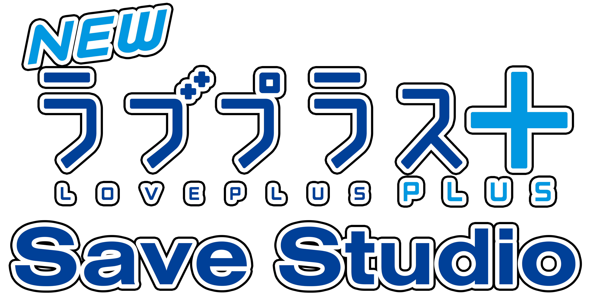
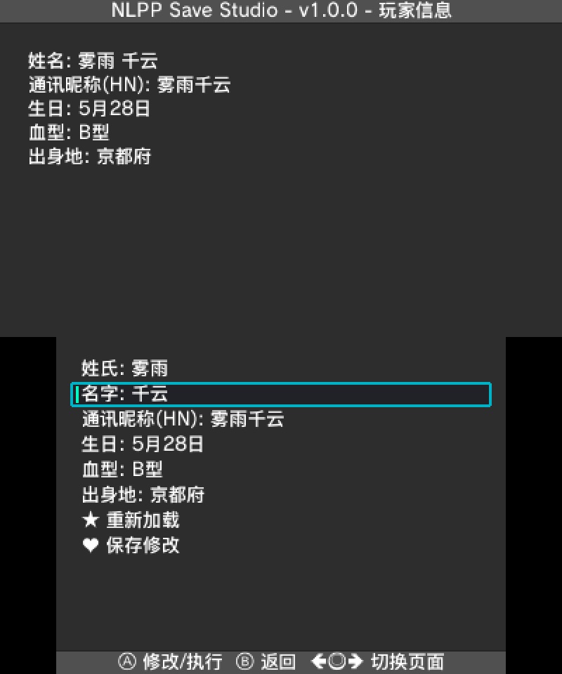

# NLPPSS
NLPPSS - NEWラブプラス+ Save Studio

<p align="left">
<a href="http://www.gnu.org/copyleft/gpl.html"></a>
<a href="https://github.com/Cetaceaqua/NLPPSS/releases/latest"></a>
<a href="https://github.com/Cetaceaqua/NLPPSS"></a>
</p>

<p align="center">
  
</p>

<h4 align="right">
  <a href="README_zh.MD">简体中文</a> | English
</h4>

<p align="center">
  
</p>

## Features

* Support reading and editing both 3DS digital and cartridge saves.
* Support automatic backup, manual backup, and save restoration.
* Support copying and clearing save slot data.
* Built-in virtual keyboard supporting Pinyin, Kana, English, numeric and symbol input, enabling Chinese text entry.
* Support light and dark UI themes.
* Multi-language user interface, supporting Simplified Chinese, English, and Traditional Chinese.
* Comprehensive save editing features:
  - Edit last name, first name, and handle nickname (HN).
  - Edit birthday, blood type, and hometown.
  - Edit last name reading, first name reading, suffix reading, preset reading, and custom reading, with quick search across all available readings.
  - Edit hair length, hairstyle, and hair color, with real-time portrait preview; support custom RGB and HEX hair colors with automatic specular highlight matching.
  - Edit total days and dating days.
  - Edit fitness, knowledge, sensibility, and charm values.
  - Edit Rich and TODO points.
  - Edit title.
  - Remove camera filters.

---

## Download & Installation

Please visit [GitHub Releases](https://github.com/Cetaceaqua/NLPPSS/releases) to download the latest release, available in multiple formats:

| Format | Target Platform | Installation & Usage |
| :--- | :--- | :--- |
| **`.cia`** | 3DS | Install using FBI or other CIA title managers. |
| **`.3dsx`** | 3DS | Place file on SD card at `/3ds/NLPPSS/NLPPSS.3dsx`, launch via Homebrew Launcher. |
| **`.cci`** | Emulator | Run directly in Azahar emulator. |

---

## Building

1. Install [devkitPro](https://devkitpro.org/) (including `devkitARM`, `libctru`, `citro2d`, `citro3d`).
2. Install required dependencies:
   ```bash
   dkp-pacman -S 3ds-curl 3ds-mbedtls 3ds-zlib
   ```
3. Install Python 3 and the `gettext` toolchain.
4. Clone the repository and compile:
   ```bash
   git clone https://github.com/Cetaceaqua/NLPPSS.git
   cd NLPPSS
   make all_formats
   ```

---

## License

Distributed under the **GNU General Public License v3.0**. See [LICENSE](./LICENSE) for details.

**Copyright © 2026 Cetaceaqua.**

**Copyright © 2024 - 2026 R-YaTian.**

---

## Credits

* **NLPPSS**
  - [Cetaceaqua](https://github.com/Cetaceaqua): Development and reverse engineering
  - Community Testers: (in no particular order)
    - 渲酱
    - 闪光
    - zhizhi0w0
    - Check
    - Anonymous
* **TYSS**
  - [R-YaTian](https://github.com/R-YaTian): Main Developer
  - [J-D-K](https://github.com/J-D-K) for the original [JKSM](https://github.com/J-D-K/JKSM) version.
  - [TuxSH](https://github.com/tuxsh) for [TWLSaveTool](https://github.com/TuxSH/TWLSaveTool), from which SPI code has been taken.
  - All [Checkpoint](https://github.com/BernardoGiordano/Checkpoint) and [PKSM](https://github.com/FlagBrew/PKSM) contributors for some code that has been ported to TYSS.
  - [WinterMute](https://github.com/WinterMute), [fincs](https://github.com/fincs) and [devkitPro](https://devkitpro.org/) contributors for devkitARM and [libctru](https://github.com/devkitPro/libctru).
  - [James-Makoto](https://github.com/James-Makoto) for testing and the TYSS logo/icon.
  - [FlagBrew](https://github.com/FlagBrew) for the original [Sharkive DB](https://github.com/FlagBrew/Sharkive).
  - [realworld](https://github.com/realkkk): Main Translator of [Sharkive DB CHS](https://github.com/R-YaTian/Sharkive).
  - [Ryuzaki-MrL](https://github.com/Ryuzaki-MrL) for the [Cthulhu](https://github.com/Ryuzaki-MrL/Cthulhu) homebrew.
